<h1 align="center">启明2 ROS2 双臂机器人</h1>

<p align="center">实物机器人驱动 · 感知与导航 · 双臂控制 · 物体抓取 · 实验示例</p>
<p align="center"><b>Ubuntu 22.04 · ROS2 Humble · C++ / Python</b></p>

<p align="center">
  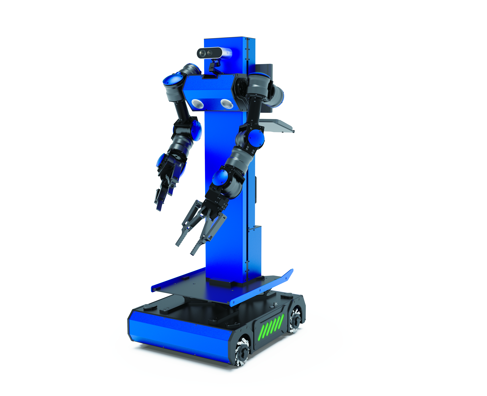
</p>

<p align="center">
  <a href="#使用步骤">使用步骤</a> ·
  <a href="#软件包结构">软件包结构</a> ·
  <a href="#功能特性">功能特性</a> ·
  <a href="#常用启动方式">常用启动方式</a> ·
  <a href="#实验示例">实验示例</a>
</p>

## 平台介绍

启明2（WPR2）是北京六部工坊科技有限公司推出的面向仿人操作应用的教学、竞赛和科研平台。整机采用模块化设计，由麦克纳姆轮全向底盘、可升降的动力脊柱、两条六自由度仿人机械臂、两指手爪、三维视觉和语音交互系统组成，适用于移动操作、具身智能及服务机器人应用研究。

本项目提供 ROS2 Humble 下的实物驱动、机器人模型、感知与导航、物品抓取、MoveIt 2 配置，以及实验一至十八的参考程序。配套传感器包括 C1 激光雷达和 Femto Bolt RGB-D 相机，底盘、上肢和里程计通过同一个串口驱动与机器人控制器通信。

## 硬件特点

### 1. 仿人机械臂

机器人搭载两条六自由度仿人机械臂，每条手臂末端配有两指手爪。关节布局参考人类手臂，支持肩、肘、腕关节运动，可用于关节控制、末端运动规划和物品操作实验。

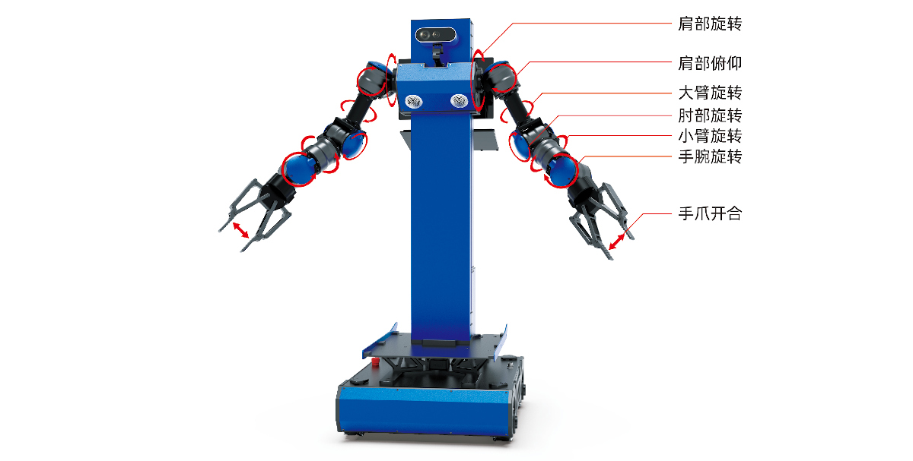

### 2. 升降机构

背部升降机构带动包括双臂和头部在内的上半身沿竖直方向移动，调整视觉观测位置和机械臂工作高度，便于识别、接近和抓取不同高度的物体。

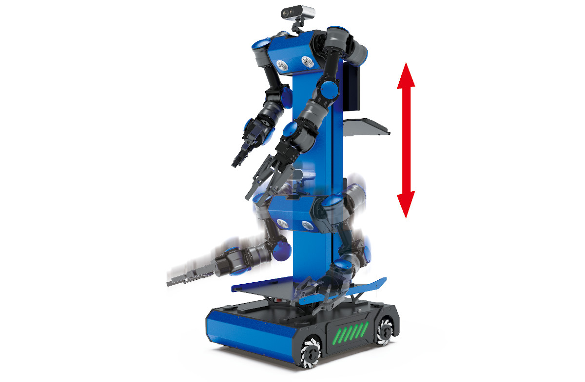

### 3. 全向移动底盘

四轮全向底盘可在保持朝向的同时向前后、左右或斜向移动，并能原地旋转，便于在导航和抓取过程中调整位姿。电机模组配有独立悬挂，编码器提供轮子转动反馈，用于里程计计算。

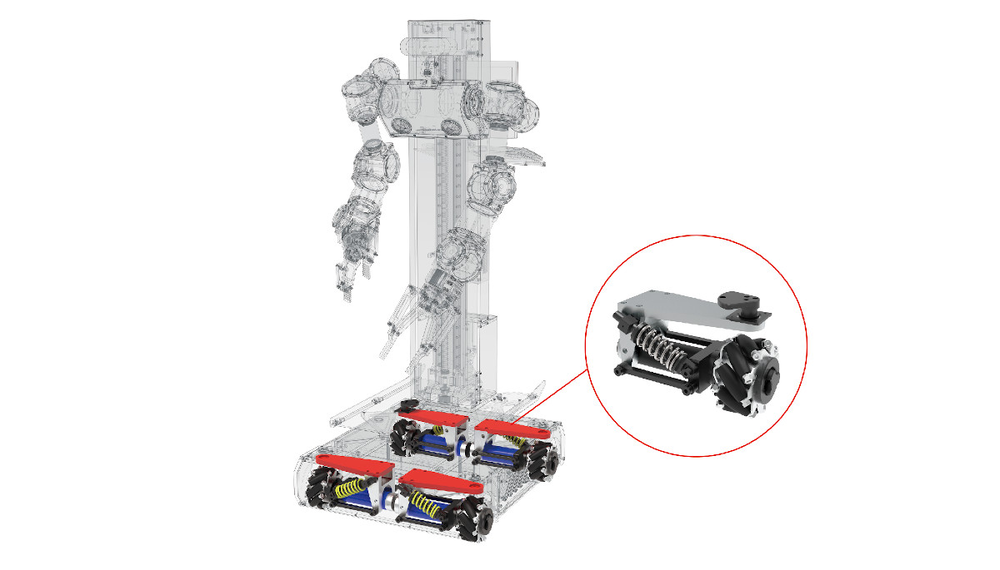

### 4. 模块化设计

底盘、躯干和双臂采用模块化结构，便于拆装、运输和维护，也方便按实验需要替换传感器或执行器，扩展机器人功能。

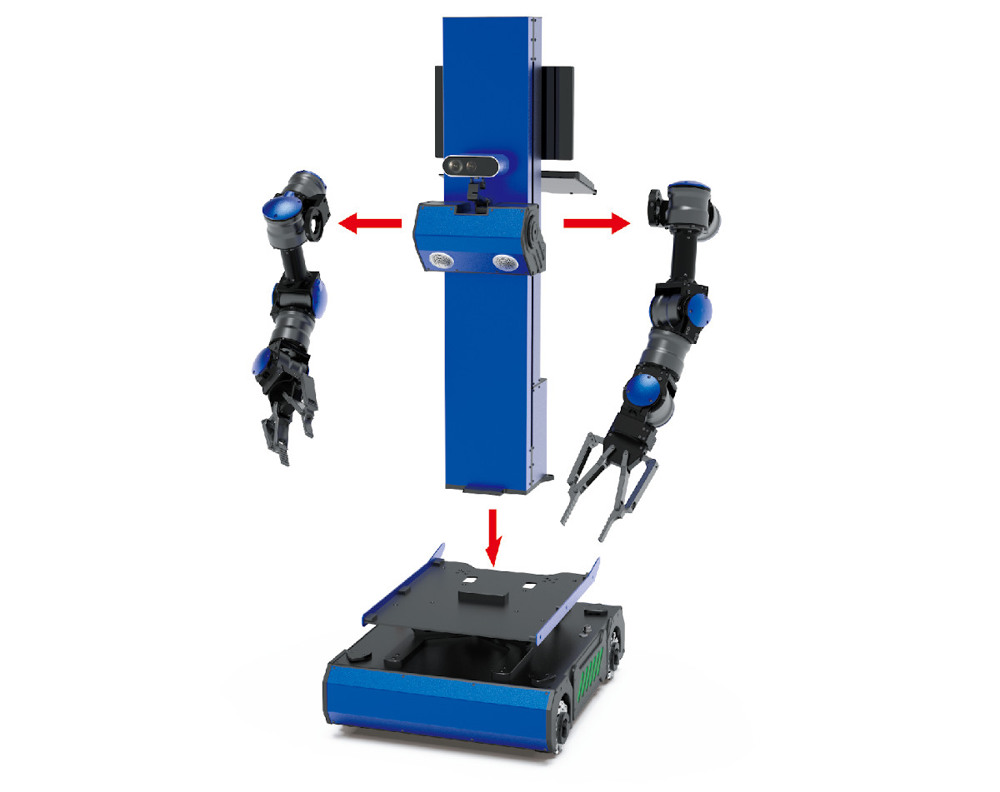

### 5. 传感器与外设

| 模块 | 功能与接口 |
| --- | --- |
| 机器人控制器 | 底盘与上肢串口通信，默认 `/dev/ftdi` |
| C1 激光雷达 | 二维扫描、建图与导航；串口默认 `/dev/rplidar`，波特率 460800 |
| Femto Bolt 相机 | 彩色图像、深度图像和彩色点云 |
| USB 手柄 | 底盘遥控 |

## 使用步骤

### 1. 准备系统

安装 Ubuntu 22.04 和 ROS2 Humble Desktop，打开终端准备构建工具：

```bash
sudo apt update
sudo apt install -y git python3-colcon-common-extensions
source /opt/ros/humble/setup.bash
```

### 2. 代码部署

创建工作空间，在 `src` 目录下载启明2机器人源码、C1雷达驱动，以及航点和语音实验所需的软件包：

```bash
mkdir -p ~/ros2_ws/src
cd ~/ros2_ws/src
git clone https://github.com/6-robot/wpr2_ros2
git clone https://github.com/Slamtec/sllidar_ros2.git
git clone https://github.com/6-robot/wp_map_tools.git
git clone https://github.com/6-robot/wp_speech
```

已有对应源码目录时，跳过相应的克隆命令。配套软件包使用 ROS2 Humble 兼容版本；各软件包的用途如下：

| 软件包 | 用途 | 获取方式 |
| --- | --- | --- |
| `sllidar_ros2` | C1 雷达驱动 | [Slamtec/sllidar_ros2](https://github.com/Slamtec/sllidar_ros2)，放入工作空间 `src` |
| `orbbec_camera`、`orbbec_description` | Femto Bolt 驱动及配套模型 | 由下方依赖脚本安装；需要修改驱动时可使用 [OrbbecSDK_ROS2](https://github.com/orbbec/OrbbecSDK_ROS2) 源码 |
| `wp_map_tools` | 实验8、18的航点编辑与导航服务 | [6-robot/wp_map_tools](https://github.com/6-robot/wp_map_tools)，准备配套 ROS2 版本 |
| `wp_speech` | 实验16、17的语音合成与识别 | [6-robot/wp_speech](https://github.com/6-robot/wp_speech)，准备配套 ROS2 版本及语音模型 |

完整实验环境的源码目录如下，相机使用系统安装的软件包时无需额外复制源码：

```text
ros2_ws/
└── src/
    ├── wpr2_ros2/
    ├── sllidar_ros2/
    ├── wp_map_tools/
    └── wp_speech/
```

### 3. 安装依赖并编译

准备好配套源码后，使用依赖脚本安装系统依赖，再编译工作空间：

```bash
source /opt/ros/humble/setup.bash
bash ~/ros2_ws/src/wpr2_ros2/wpr2_bringup/scripts/install_deps.sh
cd ~/ros2_ws
colcon build
source install/setup.bash
```

`install_deps.sh` 安装构建工具、ROSIDL、底盘、Orbbec、OpenCV/PCL、SLAM Toolbox、Nav2、MoveIt 及测试依赖，也包含配套航点和语音包的系统依赖，并同步升级已安装的 MoveIt 软件包。编译由后面的 `colcon build` 完成。外部源码包仍按上节准备；语音 Python 环境及模型按 `wp_speech` 的说明准备，实验11还需要 Python `face_recognition`。

修改源码后，回到 `~/ros2_ws` 重新执行 `colcon build`，再加载 `install/setup.bash`。

### 4. 设置设备权限

```bash
bash ~/ros2_ws/src/wpr2_ros2/wpr2_bringup/scripts/create_udev_rules.sh
```

重新插拔底盘串口、雷达和相机，检查设备：

```bash
ls -l /dev/ftdi /dev/rplidar
lsusb
```

设备规则对应配套硬件，使用其他型号时需调整规则与启动参数。

### 5. 加载环境并检查依赖

每个新终端运行节点前，先加载环境：

```bash
source ~/ros2_ws/install/setup.bash
```

运行依赖检查不会打开硬件设备，可按需要选择检查分组：

```bash
ros2 run wpr2_tutorials check_runtime.py --group base
ros2 run wpr2_tutorials check_runtime.py --group lidar
ros2 run wpr2_tutorials check_runtime.py --group camera
```

省略 `--group` 时检查全部功能，包含导航、语音和人脸检测的可选依赖。

## 软件包结构

| 软件包 | 内容 |
| --- | --- |
| [wpr2_description](wpr2_description/) | 机器人 URDF/Xacro、网格、初始关节状态和模型显示 |
| [wpr2_bringup](wpr2_bringup/) | 串口驱动、底盘与双臂控制、里程计、雷达滤波、手柄和设备规则 |
| [wpr2_tutorials](wpr2_tutorials/) | 实验一至十八的参考代码、独立 launch 和 RViz 配置 |
| [wpr2_behaviors](wpr2_behaviors/) | 三维物体检测、目标对准及物品抓取流程 |
| [wpr2_msgs](wpr2_msgs/) | 物体检测消息 `wpr2_msgs/msg/Object` |
| [wpr2_moveit_config](wpr2_moveit_config/) | MoveIt 2 规划、离线演示和实机轨迹桥接 |

各包的参数、接口和详细用法见对应目录中的 README。

## 功能特性

以下介绍对应本仓库及配套软件包已提供的 ROS2 功能。

### 1. URDF 模型描述

`wpr2_description` 提供底盘、躯干、双臂、手爪和相机的 URDF/Xacro 模型。通过 `/joint_states` 更新关节状态并发布 TF，可在 RViz2 中查看机器人结构、坐标系和当前姿态。

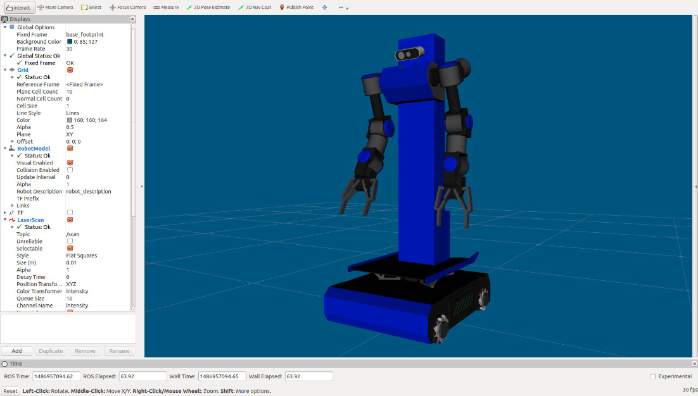

### 2. 电机码盘里程计

底盘驱动读取四轮电机编码器的反馈，换算机器人平移和旋转的里程信息，发布 `/odom` 及底盘 TF。`/odom_delta` 提供相对位移，配合 `/odom_delta_reset` 用于抓取过程中的前进、后退和对准。

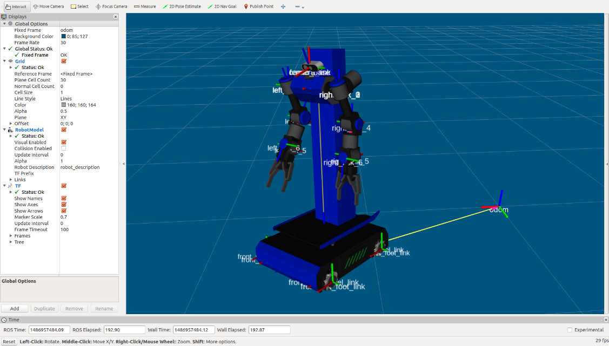

### 3. IMU 姿态传感

内置六轴 IMU 提供姿态、角速度和加速度数据，可用于姿态观察和航向控制。驱动通过 `imu_pub:=true` 开启 `/imu/data_raw` 发布；实物数据的单位与标定说明见 `wpr2_bringup/README.md`。

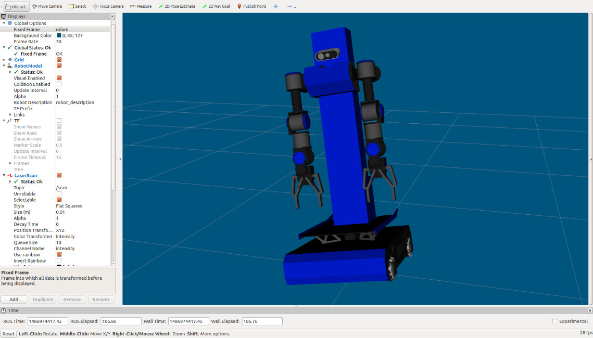

### 4. 三维立体视觉

Femto Bolt TOF RGB-D 相机提供彩色、深度图像和三维点云，用于获取环境与物体的空间信息。ROS2 通过 Orbbec 驱动接入，彩色图像话题为 `/camera/color/image_raw`，彩色点云话题为 `/camera/depth_registered/points`。

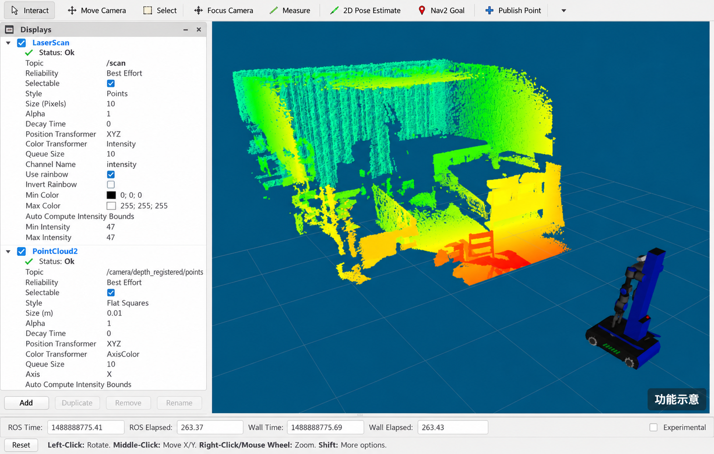

### 5. 双臂控制与运动学解算

支持左右臂关节、手爪开合和躯干升降控制。`wpr2_moveit_config` 将双臂及升降关节接入 MoveIt 2，可根据手爪末端目标位姿进行运动学解算和轨迹规划，并提供离线执行演示与可选的实机轨迹桥接。

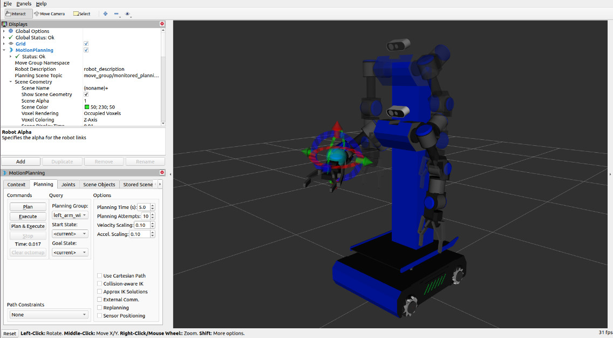

### 6. 图像处理与人脸检测

实验程序包含图像显示、HSV 颜色目标定位和人脸检测。人脸实验输出图像中的人脸矩形区域，支持学习彩色图像订阅、视觉处理和目标位置消息发布。

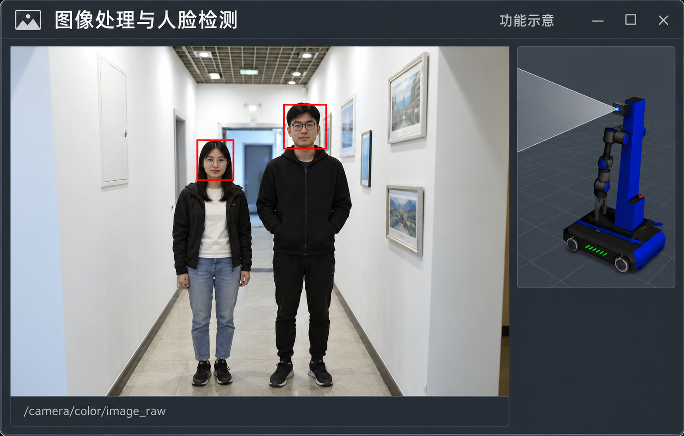

### 7. 物品检测与抓取

通过点云坐标变换、桌面分割和聚类获得物体的三维位置。抓取节点接收检测结果或指定目标坐标，依次完成观测、调整升降、底盘对准、右臂抓取、抬物和后退。检测与抓取使用本项目的 `wpr2_msgs/msg/Object` 消息。

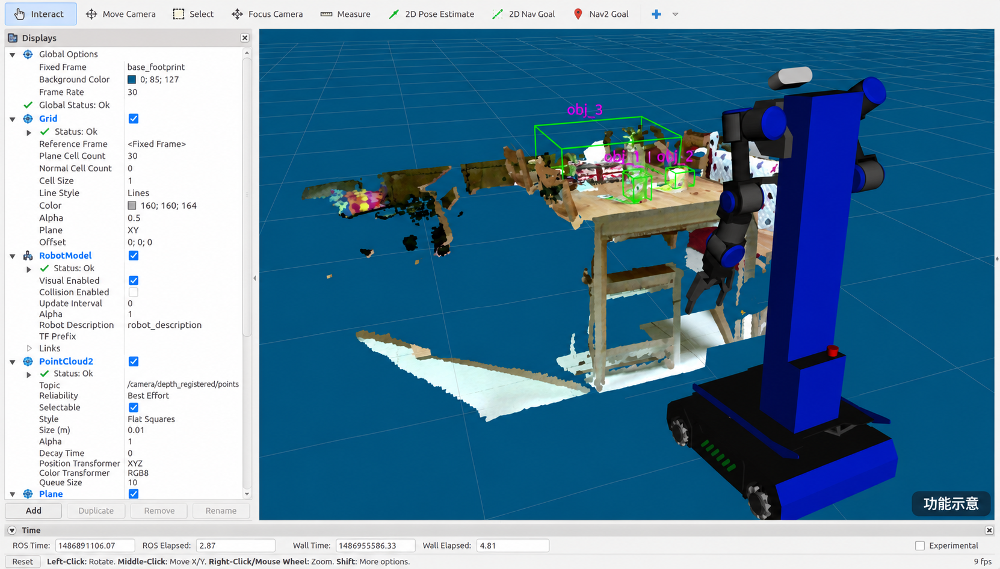

### 8. SLAM 环境建图

C1 激光雷达扫描机器人周围的障碍物，结合编码器里程计，由 SLAM Toolbox 创建二维栅格地图。支持通过手柄移动机器人完成场地扫描，并将地图保存为 `map.yaml` 和 `map.pgm`。

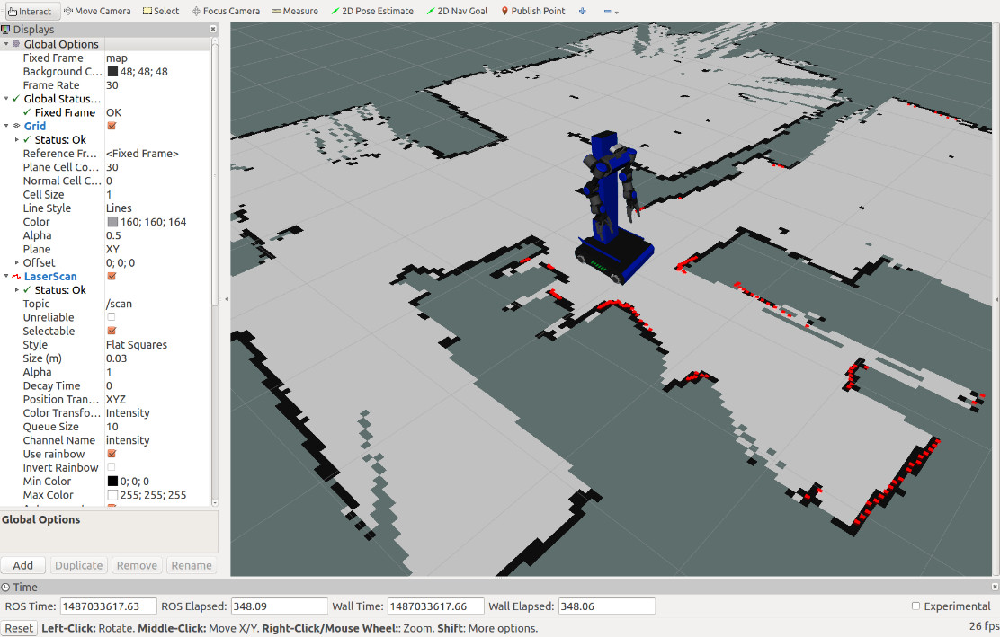

### 9. 自主定位与导航

Nav2 使用地图、激光扫描和里程计进行 AMCL 定位、路径规划及局部避障。可在 RViz2 中设置目标，也可通过 `wp_map_tools` 编辑、保存和调用命名航点。

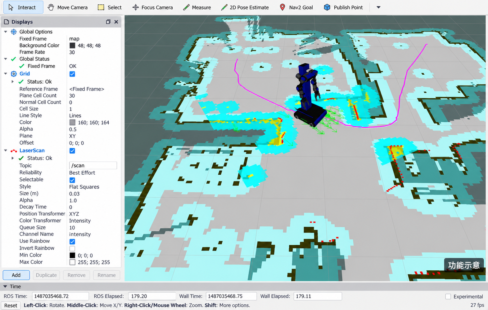

### 10. 语音交互与综合应用

配套 `wp_speech` 提供离线语音识别和语音合成。综合实验将导航、航点服务、三维物体检测和抓取行为组合起来，实现前往取物点、抓取物体，再导航至递送点的流程。

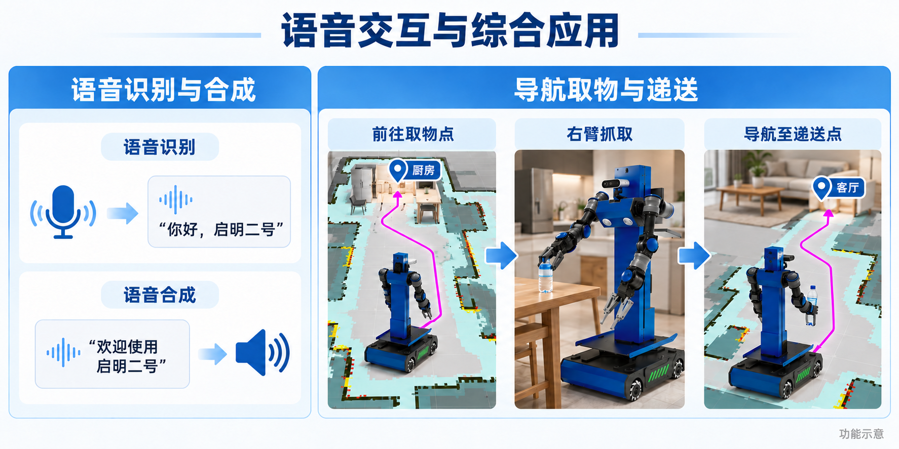

## RViz 功能展示

以下图片为功能示意，实际界面以运行时为准。

| 自主导航与定位 | Femto Bolt 三维点云 |
| :---: | :---: |
| [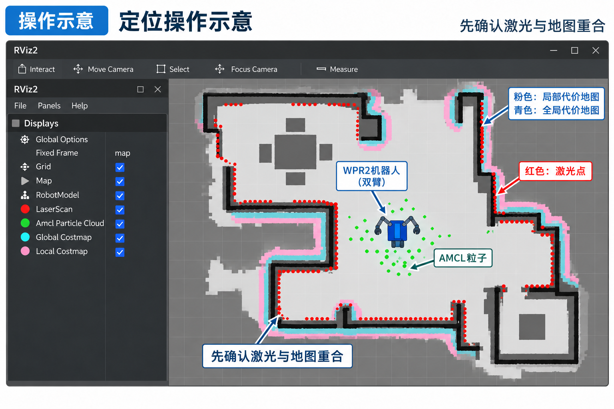](media/rviz_navigation.png) | [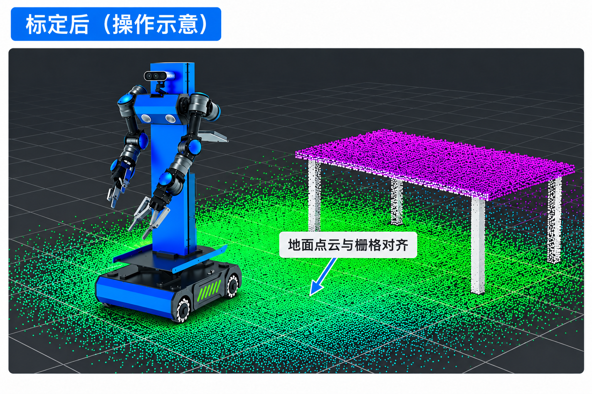](media/rviz_pointcloud.png) |
| 查看地图、激光扫描、AMCL 粒子和代价地图。 | 查看机器人模型、桌面点云及相机与地面的对齐。 |

## 常用启动方式

以下命令按功能选择运行，每个终端先加载工作空间。切换硬件启动入口前结束当前驱动，避免重复打开串口或相机。

### 查看机器人模型

```bash
ros2 launch wpr2_description urdf.launch.py
```

该入口不打开实物串口，显示 RViz2 和关节滑块。

### 启动底盘、雷达和相机

```bash
ros2 launch wpr2_bringup base_lidar_camera.launch.py
```

只使用底盘与雷达时，改用 `base_lidar.launch.py`；只使用底盘时，改用 `base.launch.py`。

### 手柄遥控

```bash
ros2 launch wpr2_bringup js_ctrl.launch.py
```

该入口包含底盘驱动和机器人 TF，不需要另外启动 `base.launch.py`。

### 查看相机图像与点云

```bash
ros2 launch wpr2_bringup femto_test.launch.py
```

该入口默认不启动底盘，在 RViz2 中查看 `/camera/depth_registered/points`；彩色图像话题为 `/camera/color/image_raw`。

### 手柄建图

终端一启动底盘、雷达与手柄：

```bash
ros2 launch wpr2_bringup base_lidar.launch.py joystick:=true
```

终端二启动建图和 RViz2：

```bash
ros2 launch wpr2_tutorials ex06_slam.launch.py
```

地图保存方法见下一节。

### 自主导航

结束建图及手柄控制，保留或重新启动一套底盘与雷达驱动：

```bash
ros2 launch wpr2_bringup base_lidar.launch.py
```

将当前场地地图保存到教程包的 `maps` 目录并重新编译，另一个终端启动导航：

```bash
ros2 launch wpr2_tutorials ex07_navigation.launch.py
```

在 RViz2 中用 **2D Pose Estimate** 设置初始位姿，确认激光与地图对齐，再用 **Nav2 Goal** 设置目标。

### 物体检测与抓取

终端一启动实物驱动、模型和相机：

```bash
ros2 launch wpr2_bringup base.launch.py enable_camera:=true
```

终端二启动检测和抓取行为，终端三发送一次开始指令：

终端二

```bash
ros2 launch wpr2_behaviors behaviors.launch.py rviz:=true
```

终端三

```bash
ros2 topic pub --once /wpr2/behavior std_msgs/msg/String '{data: "start grab"}'
```

右臂按标定姿态执行观测、检测、升降、底盘对准、抓取、抬物和后退。接收指定目标坐标的用法及抓取参数见 [wpr2_behaviors/README.md](wpr2_behaviors/README.md)。

### MoveIt 2 双臂规划

离线规划与轨迹执行演示，不打开机器人串口：

```bash
ros2 launch wpr2_moveit_config demo.launch.py
```

连接实物进行规划，默认不执行轨迹：

```bash
ros2 launch wpr2_moveit_config real_robot.launch.py
```

实机执行与轨迹桥接参数见 [wpr2_moveit_config/README.md](wpr2_moveit_config/README.md)。

### 中文语音识别与合成

终端一：中文识别

```bash
ros2 launch wpr2_tutorials ex17_bringup.launch.py
```

终端二：语音合成服务

```bash
ros2 launch wpr2_tutorials ex16_bringup.launch.py
```

终端三：发送朗读文字

```bash
ros2 topic pub --once /tts/text std_msgs/msg/String '{data: "你好，我是启明二号机器人。"}'
```

## 地图与航点

地图统一保存在 `~/ros2_ws/src/wpr2_ros2/wpr2_tutorials/maps/`，文件名为 `map.yaml` 和 `map.pgm`。仓库不提供当前场地地图，首次使用导航前需要自行建图。

保持建图节点运行，在新终端中执行：

```bash
source ~/ros2_ws/install/setup.bash
mkdir -p ~/ros2_ws/src/wpr2_ros2/wpr2_tutorials/maps
ros2 run nav2_map_server map_saver_cli -f "$HOME/ros2_ws/src/wpr2_ros2/wpr2_tutorials/maps/map" --fmt pgm
```

地图 YAML 与图像应保存在同一目录，`map.yaml` 的 `image` 字段填写 `map.pgm`。保存或更新地图后，重新编译并加载环境，将地图安装到包共享目录：

```bash
cd ~/ros2_ws
colcon build
source install/setup.bash
```

实验7和8固定从包共享目录读取地图，无需传入参数。实验8的航点固定为 `~/waypoints.xml`，不做额外文件检查；实验18也固定读取包内地图和 `~/waypoints.xml`，保留文件检查。

航点默认保存在 `~/waypoints.xml`。首次编辑航点时，分别打开以下终端；地图编辑不需要启动机器人硬件：

终端一：加载地图

```bash
ros2 run nav2_map_server map_server --ros-args -p yaml_filename:="$(ros2 pkg prefix wpr2_tutorials)/share/wpr2_tutorials/maps/map.yaml"
```

终端二：激活地图服务器，再启动航点编辑节点

```bash
ros2 lifecycle set /map_server configure
ros2 lifecycle set /map_server activate
ros2 run wp_map_tools wp_edit_node --ros-args -p load:=$HOME/waypoints.xml
```

终端三：打开配套的航点编辑界面

```bash
ros2 run rviz2 rviz2 -d "$(ros2 pkg prefix wp_map_tools)/share/wp_map_tools/rviz/edit.rviz"
```

终端四：编辑完成后保存航点

```bash
ros2 run wp_map_tools wp_saver
```

在 RViz2 中使用 **Add Waypoint** 工具添加航点。保存 XML 后，结束编辑环境，再配合底盘与雷达运行 `ex08_map_tools.launch.py` 进行航点导航。实验18需要预先保存名为 `kitchen` 和 `guest` 的航点，并在定位完成后启动任务程序。

## 实验示例

[wpr2_tutorials/examples](wpr2_tutorials/examples/) 保存参考 C++ 程序，[wpr2_tutorials/launch](wpr2_tutorials/launch/) 保存配套启动文件，采用 `exNN_` 命名。示例代码不含文字注释，相关说明见开发指南正文。每个实验先启动配套节点，再在另一终端运行示例。

以实验六“SLAM 建图”为例：

终端一

```bash
ros2 launch wpr2_tutorials ex06_bringup.launch.py
```

终端二

```bash
ros2 launch wpr2_tutorials ex06_slam.launch.py
```

| 实验 | 内容 | 实验 | 内容 |
| --- | --- | --- | --- |
| 01 | ROS2 节点入门 | 10 | 图像显示与 HSV |
| 02 | 手柄控制 | 11 | 人脸检测 |
| 03 | 速度控制 | 12 | 三维点云读取 |
| 04 | 雷达数据 | 13 | 桌面物体检测 |
| 05 | 雷达避障 | 14 | 双臂、手爪与升降 |
| 06 | SLAM 建图 | 15 | 物品抓取 |
| 07 | Nav2 导航 | 16 | 语音合成 |
| 08 | 航点导航 | 17 | 语音识别 |
| 09 | 相机安装参数调节 | 18 | 导航取物与递送 |

完整入口、运行顺序及功能依赖见 [wpr2_tutorials/README.md](wpr2_tutorials/README.md)。

## 许可证

各软件包中的许可证见其 `LICENSE` 文件，例如 [wpr2_bringup/LICENSE](wpr2_bringup/LICENSE)。第三方驱动、算法库和模型遵循各自的许可证。
